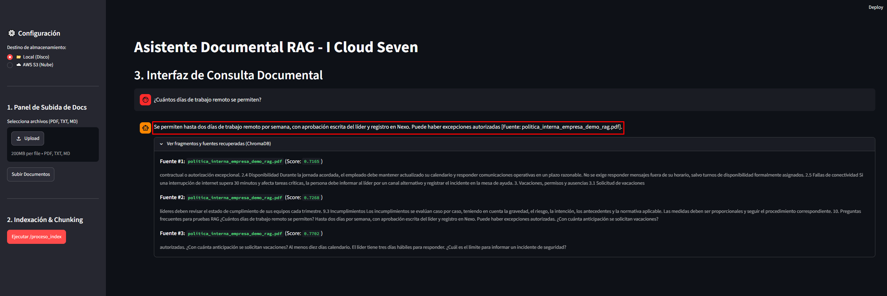
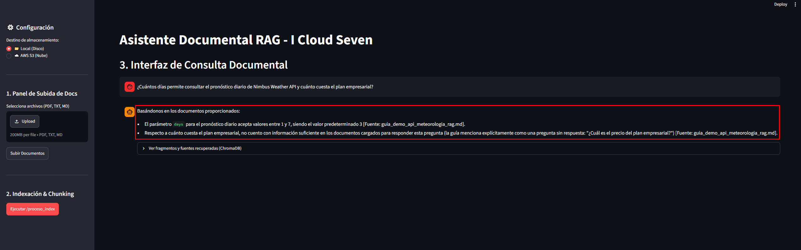
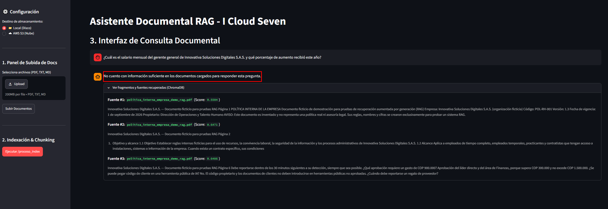

# Evidencia de Ejecución y Pruebas (Requisito 4.4)

A continuación se documentan las pruebas realizadas al Asistente Documental RAG utilizando el documento `politica_interna_empresa_demo_rag.pdf` y el .md de `guia_demo_api_meteorologia_rag`.

## Prueba 1: Pregunta respondible con los documentos
**Objetivo:** Verificar que el sistema extrae la información correcta y cita la fuente.
* **Pregunta:** *¿Cuántos días de trabajo remoto se permiten?*
* **Respuesta del Asistente:** "Se permiten hasta dos días de trabajo remoto por semana, con aprobación escrita del líder y registro en Nexo. Puede haber excepciones autorizadas [Fuente: politica_interna_empresa_demo_rag.pdf]."
* **Evidencia:** 
**

## Prueba 2: Pregunta parcialmente respondible
**Objetivo:** Verificar que el LLM identifica qué sabe y qué no sabe.
* **Pregunta:** *¿Cuántos días permite consultar el pronóstico diario de Nimbus Weather API y cuánto cuesta el plan empresarial?*
* **Respuesta del Asistente:** "El parámetro days para el pronóstico diario acepta valores entre 1 y 7, siendo el valor predeterminado 3 [Fuente: guia_demo_api_meteorologia_rag.md].Respecto a cuánto cuesta el plan empresarial, no cuento con información suficiente en los documentos cargados para responder la pregunta [Fuente: guia_demo_api_meteorologia_rag.md]."
* **Evidencia:**
**

## Prueba 3: Pregunta fuera de contexto (Mitigación de Alucinación)
**Objetivo:** Comprobar que el sistema no inventa información externa gracias al prompt estricto y la temperatura en 0.
* **Pregunta:** *¿Cuál es el salario mensual del gerente general de Innovativa Soluciones Digitales S.A.S. y qué porcentaje de aumento recibió este año?*
* **Respuesta del Asistente:** "No cuento con información suficiente en los documentos cargados para responder esta pregunta."
* **Evidencia:**
**